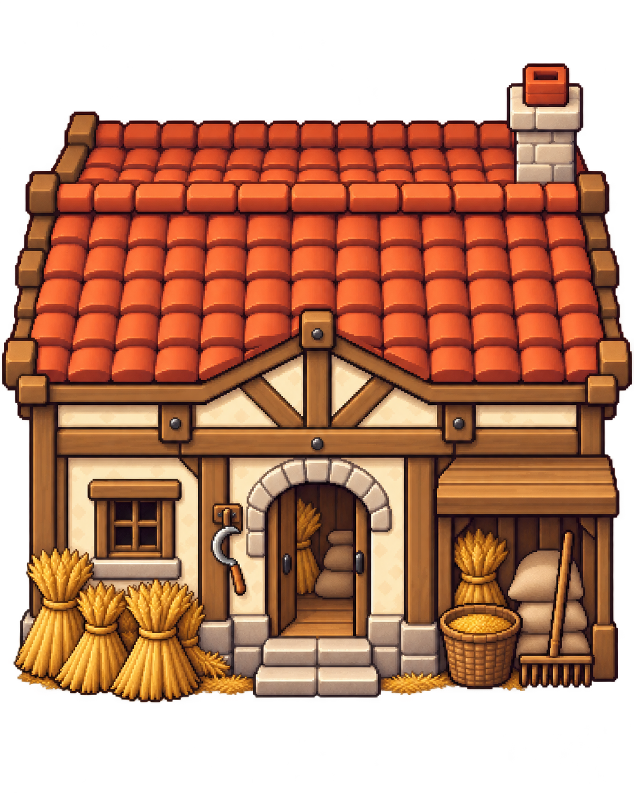

# Crowned Kingdoms — Art Style Guide

Quy chuẩn bắt buộc cho mọi asset hình. Art tạm sinh bằng code (`src/render/*Art.ts`) cũng tuân theo file này. Nguồn chuẩn: spec tổng §11 ([2026-10-16-crowned-kingdoms-design.md](superpowers/specs/2026-10-16-crowned-kingdoms-design.md)).

Không khí: **fantasy ấm áp, dễ thương** — vương quốc nhỏ, lính chibi, đồng lúa, rừng cây, giao diện gỗ + giấy kem kiểu Stardew Valley.

Nguồn luật màu/kích thước mở: **yêu cầu chủ dự án ngày 23/10/2026**, thay thế giới hạn cũ. Không giới hạn RGB hoặc số lượng màu cho thế giới và UI; giữ các export/màu cũ để tương thích.

## Kích thước theo metadata

Giữ ô logic **32 px** và sân logic **384 px**, không đổi mô phỏng theo art. Kích thước canvas/frame là số nguyên dương, khai báo và kiểm đúng metadata (đơn vị theo `UnitDef.sprite`, UI qua `uiFrameDef`); không có danh sách kích thước đóng. Bảng dưới ghi các kích thước hiện tại để tham khảo. G3e giữ công trình 32×40, Ngai 32×48 và kích thước lính hiện tại, không biến chúng thành giới hạn chung.

| Thứ                        | Kích thước             | Ghi chú                                                                        |
| -------------------------- | ---------------------- | ------------------------------------------------------------------------------ |
| Tile cánh đồng             | 16×16                  | Dual-grid (cỏ < cỏ hoa < đường đất < cát; ao là nước)                          |
| Ô bàn cờ                   | 32×32                  | Ô mở trống (đất xới viền cỏ), ô khoá (cỏ rậm + cọc rào + biển giá), bệ Ngai đá |
| Công trình                 | 32×40                  | Đứng trên mép dưới ô, phần cao 8 px tràn lên ô phía Bắc (y-sort)               |
| Ngai                       | 32×48                  |                                                                                |
| Lính nhỏ chibi             | 16×16                  | Dân quân, sói, nhện, xương…; đầu ≈ 40% chiều cao                               |
| Lính cao                   | 16×24                  | Người cầm vũ khí dài, pháp sư, kỵ binh                                         |
| Lính lớn                   | 24×24 / 24×32          | Người đá, gấu, cổ thụ, rồng sắt, khổng lồ đồng, thần chết                      |
| Boss                       | 48×48                  |                                                                                |
| Đạn / hiệu ứng             | 4×4 – 8×8              | Tia lửa, mũi tên (4 hướng + 4 chéo, vẽ riêng, không xoay), đá, bùn             |
| Tảng đá can thiệp          | 16×16 + bóng 24×8      |                                                                                |
| Tranh thẻ                  | 32×24                  | Cửa sổ tranh trong `CardView`                                                  |
| Icon loại thẻ / tài nguyên | 16×16                  |                                                                                |
| Chân dung vua              | 32×32                  | Ghép trong ô chọn vua                                                          |
| Khung thẻ (UI)             | ô nguồn 24×32, slice 8 | `card`, `cardUncommon`, `cardRare`, `cardSelected`                             |

## Màu sắc

`PALETTE` (Hearth 32, `src/data/palette.ts`) và `UI_PALETTE` (`src/data/uiPalette.ts`) là các màu semantic hiện hữu để tương thích, không phải danh sách RGB bắt buộc hoặc giới hạn số màu.

Ngôn ngữ thị giác: tông ấm, bão hoà vừa; bóng nâu–mận; **xanh dương = phe mình, đỏ = phe địch**, kết hợp hình/viền để phân biệt phe. Mép sprite chỉ alpha **0/255**; bóng riêng được alpha **128** khi có khai báo.

## Giao diện (UI)

Các màu semantic và kích thước khung bên dưới mô tả skin hiện hữu, không giới hạn màu/kích thước của skin mới. Nút dùng `createButton`, tooltip dùng `Tooltip`, hộp tự định cỡ dùng `ContentBox`; giữ các primitive này khi thay art.

**Luật:** màu UI theo metadata mở, không bắt buộc thuộc `UI_PALETTE`. UI giữ tông ấm và sáng (khung gỗ nâu, lõi giấy kem, chữ nâu đậm có bóng) giống Stardew Valley; giữ tương phản và ý nghĩa trạng thái.

**Ngoại lệ có đăng ký:** các khung panel/tooltip/nút/thẻ lấy từ bộ [Pixel UI Pack](https://kenney.nl/assets/pixel-ui-pack) của Kenney (CC0, `public/assets/ui/kenney-pixel-ui/`, đăng ký trong `docs/assets.manifest.yml`) được nạp đè lên khung sinh ra bởi `paintUiFrame` (xem `src/render/uiKit.ts`) — màu của chúng không thuộc `UI_PALETTE`. Ô hotbar, thanh, decor vẫn sinh từ `UI_PALETTE`; file kit thiếu/lỗi thì rơi về khung sinh.

- Art UI sinh bằng code trong `src/render/uiArt.ts` (kiểm kích thước theo metadata, góc/slice/border và trạng thái), đóng gói thành texture `ui` trong `PreloadScene` (`buildUiTexture`).
- Mọi khung là **9-slice**, vẽ bằng `createPanel` (`src/ui/theme.ts`) theo kích thước logic. Viền scale nguyên lần: `uiScale = 2` khi cạnh ngắn màn hình ≥ 600 px, ngược lại `1`.
- Chữ trên nền kem: `FONT_UI`, màu `text`, bóng `textShadow` lệch (+1, +1). Vàng `gold` không dùng cho chữ trên nền kem (không đủ tương phản).
- Lớp phủ trên thế giới (ô hợp lệ/không hợp lệ, vòng ngắm, mũi tên mép) dùng `good`, `bad`, `gold` của `UI_PALETTE`.

| Frame                                                    | Ô nguồn | Góc (slice) | Viền (border) | Dùng cho                                            |
| -------------------------------------------------------- | ------- | ----------- | ------------- | --------------------------------------------------- |
| `panel`                                                  | 24×24   | 8           | 6             | Bảng logo, panel HUD, bảng phụ                      |
| `button` / `buttonHover` / `buttonDown` / `buttonActive` | 16×16   | 5           | 4             | Nút; hover lõi sáng, bấm lõm, đang bật viền vàng    |
| `slot` / `slotHover` / `slotSelected`                    | 18×18   | 4           | 2 / 2 / 3     | Ô lịch, ô chọn vua; đang chọn viền đỏ `select` 2 px |
| `tooltip`                                                | 12×12   | 4           | 2             | Tooltip, toast, dòng hướng dẫn                      |
| `bar`                                                    | 8×6     | 2           | 1             | Khung thanh (HP Ngai, thông thạo)                   |
| `clockDial` (không giãn)                                 | 28×28   | —           | —             | Mặt đồng hồ (dự phòng, chưa dùng ở G0)              |
| `firefly` (không giãn)                                   | 3×3     | —           | —             | Đom đóm menu                                        |

Khung thẻ theo độ hiếm (thêm vào texture `ui` từ G1): thường = viền `wood`; vừa = viền đôi `woodLight`; hiếm = viền trong `gold`; đang chọn = viền ngoài `select` 2 px.

**Menu chính:** trời 4 dải `UI_PALETTE.sky` nối bằng dither 2×2, 3 lớp đồi/cây silhouette (`woodDark` → `text` → `outline`, xa → gần) trôi parallax 4/8/16 px/s, cỡ pixel nguyên `menuPixelScale`.

## Quy tắc vẽ

- Ánh sáng từ **trên-trái**: viền trên-trái sáng hơn, viền dưới-phải tối hơn.
- Không anti-aliasing, blur, glow mờ hoặc gradient mượt; dither thưa nếu cần chuyển tông.
- Đơn vị vẽ bằng `paintBitmap` với ký tự màu cố định: `c` = màu vải → màu chủ của vua; `o` = viền → `outline` (phe mình) hoặc `redDark` (phe địch, kèm 1 pixel cờ `red`). Atlas sinh hai biến thể `unit_<id>_ally` và `unit_<id>_foe`.
- Hoạt ảnh: idle 2 frame, đi 2 frame (nhún 1 px), đánh 2 frame; 6–8 fps idle/đi, 10–12 fps đánh.
- **Không xoay sprite**; lật ngang để quay trái/phải được phép. **Neo ở chân** (origin 0.5, 1) và xếp chiều sâu theo y của chân (y-sort).
- Chi tiết 1 px trên tile phải thưa (≤ 10% diện tích) để đơn vị đứng trên vẫn đọc được.

## Góc nhìn

> **BẮT BUỘC cho mọi lần tạo ảnh (người hay AI/Codex).** Trước khi tạo hoặc yêu cầu tạo BẤT KỲ ảnh nào cho game (công trình, lính, địa hình, vật trang trí, tường núi, icon…), phải: (1) đọc hết mục "Góc nhìn" này và mục "Quy tắc vẽ" ở trên; (2) đính kèm ảnh tham chiếu đã duyệt `art-review/style-references/harvester-house-front-approved.png` cho mọi công trình, và ảnh đã duyệt cùng loại (nếu có) cho loại khác; (3) dựng prompt từ **Prompt mẫu dùng lại** bên dưới (công cụ `docs/art-review/g3e/buildings/make_prompts.py` lấy đúng khối này, không tự chép lại); (4) duyệt kết quả bằng **Kiểm trước khi duyệt**. Prompt không dẫn tới tài liệu này hoặc thiếu ảnh tham chiếu thì không được chạy. Ảnh đi ngược các điểm trên bị loại, không "sửa dần" sau khi đã thêm chi tiết.

Từ 26/10/2026 cảnh theo **Stardew Valley 2.5D** (đã chốt với chủ dự án), không còn nhìn thẳng từ trên xuống và không phải isometric. Camera nhìn xuống ~60°, mặt đất là lưới vuông; vật đứng được vẽ như sau:

- **Công trình = mái lớn + mặt tiền ngắn:** mái chiếm ~50% chiều cao sprite, nhìn từ trên xuống, thấy rõ mặt phẳng mái dốc với từng hàng ngói/rơm/ván chạy ngang; mặt tiền ngắn hơn mái (~35–40%), cửa chính ở giữa, có đổ bóng dưới mái lên tường; chân móng ngắn. **Không thấy tường bên**, không xoay công trình, không hình thoi 2:1. Cạnh ngang nằm ngang, cạnh đứng nằm đứng, hình dáng gần đối xứng trái–phải.
- **Vật phẳng trên đất** (ruộng, vòng pháp thuật, hồ): thấy mặt đất là hình chữ nhật rộng, phần nhô lên (hàng rào, bậc) có chiều cao thấy rõ.
- **Vách núi và tường đá:** thấy mặt vách hướng về người chơi, đỉnh vách và biển/trời phía sau (xem [spec](superpowers/specs/2026-10-26-oblique-view-mountain-wall-design.md)).
- **Quy ước chung:** ánh sáng trên-trái; viền là màu tối hơn của chính vật liệu (không viền đen thuần); bão hòa ấm; họa tiết chất liệu (ngói, ván, đá) rõ; neo chân công trình ở đáy sprite và y-sort.
- Hai nhà tranh/trại lính của lô `ai-v1` đầu tiên (thấy hai mặt) sẽ được vẽ lại theo quy ước này; các nhóm công trình mới đều theo quy ước này.

### Mẫu công trình chính diện đã duyệt — nhà đội Thợ Gặt (26/10/2026)



Ảnh trên là **mẫu phong cách đã được chủ dự án duyệt trong chat**, dùng làm tham chiếu cho các lần tạo công trình sau. Đây là concept phóng lớn, chưa phải sprite native đã kiểm pixel/alpha và chưa được đưa vào game. Tên đúng là **Thợ Gặt** (thu hoạch lúa), không phải Thợ Gạch. Ảnh này do AI tạo cho chủ dự án (không phải ảnh của game khác), lưu trong repo chỉ để làm tham chiếu và không được đưa vào game.

- **Hướng nhà luôn thẳng chính diện:** mặt tiền đối diện người xem; hai chân góc mặt tiền cùng cao độ; xà ngang, bậu cửa và chân móng nằm ngang; cột đứng thẳng. Không thấy tường bên trái/phải, không xoay chéo, không isometric.
- **Điểm nhìn cao, không nghiêng sang bên:** thấy mái từ trên xuống nhưng mặt tiền vẫn thẳng. Góc khoảng 60° trong quy ước chung là gợi ý; ảnh tham chiếu và các dấu hiệu hình học này là tiêu chí duyệt, không phải phép đo camera chính xác.
- **Mái chạy ngang:** sống mái từ trái sang phải, song song mặt tiền; mặt mái trước rộng, có dải mái phía sau sống mái ở phía trên như ảnh mẫu. Thể hiện phần mái sau bằng cách vẽ cách điệu, không xoay cả ngôi nhà để lộ mái. Tránh mái có sống chạy chéo sâu vào màn hình hoặc đầu hồi cao che hết mái sau.
- Hình khối gọn, gần cân đối; cửa chính ở giữa, đồ nghề có thể lệch hai bên. Ngói đất nung, gỗ nâu, tường vữa ấm; bó lúa vàng, liềm, cào, giỏ thóc và bao hạt nhận diện đội Thợ Gặt. Công trình khác thay vật liệu/đồ nghề theo chức năng, giữ cùng góc nhìn.
- Pixel rõ cụm, ánh sáng trên-trái, nền trong suốt, toàn bộ mái và chân nhà nằm trong ảnh có khoảng đệm. Khi làm sprite thật phải giảm chi tiết theo kích thước native; không coi số pixel của concept là kích thước sản xuất.

**Prompt mẫu dùng lại** (đính kèm ảnh tham chiếu trên; thay phần trong ngoặc vuông):

```text
Create one isolated pixel-art building for Crowned Kingdoms: [building and function].
Use the attached approved harvester house as the camera and style reference.
STRICT straight-on FRONT VIEW with a high downward viewpoint, orthographic game-art styling.
Front facade faces the viewer exactly; horizontal beams, sills, foundation and eaves stay horizontal;
vertical posts stay vertical; both front corners have the same height. No visible side walls.
NO diagonal building rotation, NO isometric view, NO diamond ground base.
Roof ridge runs LEFT TO RIGHT, parallel to the facade. Show a broad front roof plane and a
smaller rear roof strip above the ridge, matching the reference's stylized roof geometry.
Keep the house front-facing while revealing the roof; do not turn it sideways.
Compact readable silhouette, cozy warm medieval pixel art, crisp square pixel clusters,
upper-left lighting, dark material-colored outlines. [Materials and identifying tools.]
Whole building visible, transparent background, padding around roof and feet.
No people, text, labels, UI, watermark, blur or antialiasing.
Concept preview only; native sprite size and pixel cleanup are a separate production step.
```

> Khi tạo qua Codex/imagegen để cắt sprite trong repo, thay dòng "transparent background" bằng nền **đen phẳng #000000** (không quầng sáng, không bóng, không nền đất): công cụ `make_assets.py` tách nền đen thành alpha 0/255 rồi thu nhỏ về 64 px ảnh rộng. Chiều cao tối đa 80 px ảnh (một ô bàn cờ); công trình thấp (ruộng) có thể thấp hơn.

**Kiểm trước khi duyệt:** mặt tiền thẳng · không lộ tường bên · mái có chiều sâu mà nhà không xoay · nhận ra chức năng · đủ mái/chân · đọc được khi thu nhỏ. Nếu ảnh bị xéo, sửa hướng nhà trước khi thêm chi tiết.

## Hiển thị

- Game chạy `pixelArt: true` (nearest-neighbour) và **zoom số nguyên** (vương quốc: zoom 2; trận: `max(1, floor(min(width, height + 96) / 384))`). Không bao giờ scale lẻ; sprite/scroll hiển thị snap pixel, không sửa float của world để snap render. Chữ `FONT_UI` vẽ ở kích thước hiển thị gốc, không scale texture text theo tỷ lệ lẻ; kiểm độ rõ/glyph tiếng Việt bằng browser.

## Pipeline art sinh bằng code

- Giữ `PixelCanvas`/`pixelHash` (`pixel.ts`), `paintBitmap` (`bitmap.ts`), `dualGrid.ts`. Module mới (thuần TS, kiểm geometry/alpha theo metadata) đến từ G1: `fieldArt.ts`, `plotArt.ts`, `buildingArt.ts`, `unitArt.ts`, `cardArt.ts`, `iconArt.ts`, `fxArt.ts` (đã có từ G1); `portraitArt.ts` chưa làm (G2+).
- `atlas.ts` dựng texture `ui` (G0), `field-tiles` và `sprites` (một atlas thế giới, mỗi chiều ≤ 4096), frame theo tên: `building_<cardId>`, `unit_<id>_<team>_<anim><n>`, `card_art_<cardId>`, `icon_<id>`, `fx_<id>`.

## Ranh giới thay art thật

Hợp đồng **từ G1** (spec §11.4): mọi chỗ dùng sprite chỉ gọi frame theo tên qua các hàm `*Frame(...)` trong `atlas.ts`. Thay bằng atlas Aseprite = xuất atlas với **cùng tên frame** (`.aseprite` → spritesheet + JSON → `public/assets/atlases/`), nạp trong `PreloadScene` dưới cùng key; không sửa scene. Riêng UI: nạp dưới key `ui` thay cho `buildUiTexture`, khai báo metadata kích thước/slice/border và đọc qua `uiFrameDef`.

## Nguồn asset tạm

Pack CC0/CC-BY từ itch.io, Kenney, OpenGameArt — ghi vào `CREDITS.md` kèm license. Ảnh AI do chủ dự án cung cấp là nguồn hợp lệ cho sprite cuối (xem mục "Asset ngoài & AI"), phải đi qua quy trình duyệt từng nhóm.

## Asset ngoài & AI

- Mọi asset ngoài phải qua [ASSET_LICENSES.md](ASSET_LICENSES.md) và được ghi vào [ASSET_MANIFEST.md](ASSET_MANIFEST.md) (dữ liệu ở `docs/assets.manifest.yml`) + `CREDITS.md` trước khi commit. Không tự tải rồi commit chỉ vì thấy URL.
- Ảnh AI (OpenAI imagegen qua Codex, do chủ dự án cung cấp và duyệt từng nhóm) dùng làm nguồn cho sprite cuối: không đưa nguyên ảnh vào atlas mà phải `ảnh nguồn → tách nền → thu nhỏ về native size → kiểm alpha/pixel → duyệt → đăng ký (assets.manifest.yml, CREDITS.md)`; nguồn và prompt lưu trong `docs/art-review/`. Mọi lần tạo ảnh tuân thủ khung BẮT BUỘC ở mục "Góc nhìn".
- Asset chưa đạt yêu cầu: đánh dấu TODO, không tự ý đổi native size/projection, không xoay sprite, giữ nguyên frame name khi thay art.
- Checklist nghiệm thu: đúng native size theo metadata · đúng projection · màu mở, phân biệt phe/trạng thái · mép alpha 0/255, bóng riêng alpha 128 có khai báo · không anti-aliasing/blur/gradient mượt · ánh sáng trên-trái · silhouette đọc được ở 1× · origin (0.5, 1) · đúng frame name · license đã ghi.
